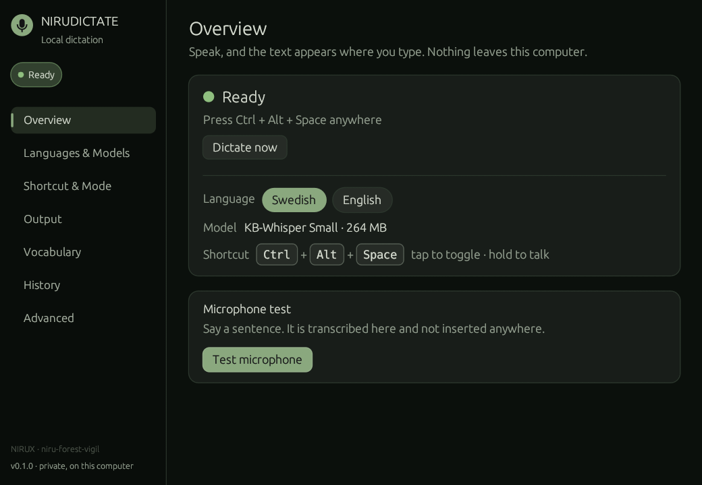

# NIRUDICTATE

Local speech-to-text dictation: press Ctrl+Alt+Space, speak, and the text appears where you type. Press Shift+Alt+Space instead to talk to the opencode agent.

**Status: alpha** · Part of the [NIRUX](https://github.com/nirucon/nirux) suite · [MIT License](LICENSE)



## About

NIRUDICTATE turns speech into text on this computer and inserts it in the window
you are typing in: a terminal, a browser, a mail, a chat. Swedish by default,
English one click away. It is an optional NIRUX extra, and it also works on
other X11 desktops.

- **Private.** Speech is transcribed locally by
  [whisper.cpp](https://github.com/ggml-org/whisper.cpp). Nothing is sent
  anywhere; the network is used only to download a model, once.
- **Swedish first.** Swedish uses [KB-Whisper](https://huggingface.co/KBLab)
  from KBLab, the National Library of Sweden's data lab, trained on 50 000 hours
  of Swedish. English uses OpenAI's Whisper.
- **Talk to an agent.** Shift+Alt+Space sends what you say to
  [opencode](https://opencode.ai) instead of typing it. The opencode window
  lives in NIRUWM scratchpad 9 and comes to the front with each message.
- **Out of the way.** A small overlay at the bottom of the screen while you
  speak and a red dot in NIRUBAR, nothing else. The background service uses no
  CPU while idle, opens the microphone only while you dictate, and frees the
  model after ten idle minutes.

### How it works

The service waits for the shortcut without any timer. On a press it starts
`pw-record` for 16 kHz mono audio, shows the overlay and preloads the model.
When you stop, silence at the ends is trimmed and whisper.cpp transcribes the
speech on a background thread at low priority (nice 10, SCHED_BATCH, at most
one thread per physical core), so music, visualizers and the desktop stay
smooth. The text is cleaned up (known silence hallucinations such as subtitle
credits are dropped), put on the clipboard, pasted with XTest, and the
previous clipboard is put back with everything it held. If the window does not
take the paste, the text is typed instead. See
[docs/ARCHITECTURE.md](docs/ARCHITECTURE.md).

## Features

- Global shortcut (default `Ctrl+Alt+Space`) with hybrid, toggle and
  push-to-talk modes; NIRUDICTATE listens for it itself, so no window-manager
  binding is needed.
- Swedish (KB-Whisper) and English (Whisper) models from Tiny to Large, with a
  per-computer recommendation based on measured speed.
- Paste or type output, clipboard restored afterwards, terminal-aware paste,
  capital letter and trailing space.
- Vocabulary for names and jargon, a local history, microphone test.
- A control panel that follows the NIRUX theme (and the Omarchy theme outside
  NIRUX) live.
- NIRUX integration: NIRUBAR `dictation` module, `dictation` sound category,
  started by the NIRUX session.
- Checksum-verified, resumable model downloads.
- Agent mode (`Shift+Alt+Space`): local transcription, a short confirmation,
  then the text goes to opencode through its own server API, in one ongoing
  conversation (a double tap starts a new one). See
  [Agent mode](#agent-mode-opencode).

### Privacy

- Audio stays in memory, is transcribed on this computer and is then
  discarded. It is never written to disk (except the panel's microphone test,
  which writes a temporary file in your private runtime directory and deletes
  it at once).
- The history is a local file, `~/.local/state/nirudictate/history.jsonl`,
  readable only by you (0600). Turn it off or clear it in the panel.
- Network access: only the model downloads, from GitHub (Swedish models) and
  Hugging Face (English models). No telemetry, no update checks.
- The microphone is opened only while you dictate: the recorder process
  exists only then, so PipeWire shows NIRUDICTATE as a recording client only
  while the red dot is on.
- Agent mode is the one exception to "nothing leaves this computer": the
  speech is still transcribed locally, but the *text* you confirm is handed to
  opencode, which sends it to the AI provider that opencode is set up to use.
  Nothing is sent when you press Esc in the confirmation box.

## Requirements

- x86_64 with Debian 12/13, Arch or Void (glibc 2.35 or newer).
- X11 (NIRUWM or any other X11 desktop) with XTest.
- OpenGL and `libxkbcommon-x11` for the panel (every NIRUX install has them).
- A recorder: `pw-record` (PipeWire), or `parec`/`arecord` without PipeWire.
- Agent mode only: [opencode](https://opencode.ai) 1.x or 2.x with a provider
  set up, and a terminal (kitty, alacritty or xterm). NIRUWM 0.17.9 or newer
  keeps the opencode window in scratchpad 9; with an older window manager it
  opens as a normal window.

| Distribution | Package with the recorder |
|---|---|
| Debian / Ubuntu | `pipewire-bin` (or `pulseaudio-utils`, `alsa-utils`) |
| Arch | `pipewire` (or `libpulse`, `alsa-utils`) |
| Void | `pipewire` (or `pulseaudio-utils`, `alsa-utils`) |

The release contains two whisper.cpp builds, one for CPUs with AVX2 and FMA
(most x86_64 computers since 2013–2015) and a baseline one for older CPUs;
NIRUDICTATE picks the right one when it starts.

## Installation

### With NIRUX

```sh
nirux extras install nirudictate
nirux extras update            # later, for the extras you selected
```

NIRUX downloads the pinned, checksum-verified release, installs it in
`~/.local` and starts the service in your running session. The NIRUX session
(NIRUWM 0.17.3 or newer) starts the service at every login on Debian, Arch and
Void alike, without systemd user units.

### Standalone

```sh
git clone https://github.com/nirucon/nirudictate
cd nirudictate
./install.sh            # prebuilt binaries; --source builds with cargo, --no-start skips starting the service
```

The installer puts `nirudictate` in `~/.local/bin`, a launcher entry in
`~/.local/share/applications`, an XDG autostart entry for other desktops
(GNOME, KDE, Xfce, …) and starts the service. It needs no root.

## Usage

### First run

1. Open **NIRUDICTATE** from the launcher (or run `nirudictate settings`).
2. The Overview shows the recommended Swedish model for this computer. Click
   **Download** (about 260 MB for *KB-Whisper Small*). The file is checked
   against its SHA-256 before it is used.
3. Click **Test microphone**, say a sentence and see what comes out.
4. Put the cursor in any text field, press **Ctrl+Alt+Space**, speak, and
   pause. The text is inserted.

If you press the shortcut before a model is installed, the panel opens by itself.

### Agent mode (opencode)

**Shift+Alt+Space** works like the dictation shortcut (tap to start and it
stops after a pause, or hold while you speak), but the text goes to
[opencode](https://opencode.ai) instead of the window you type in:

1. You speak; the speech is transcribed on this computer as usual. The
   overlay shows **AI** next to the language while it records.
2. A small box at the bottom of the screen shows the text. It **sends by
   itself after 2 seconds**; **Enter** sends at once, **Esc** cancels and
   nothing is sent.
3. NIRUDICTATE hands the text to opencode through opencode's own server API
   (not by typing into a window, and never on a command line). The opencode
   window, in **NIRUWM scratchpad 9** (**Super+Alt+9**), comes to the front
   and shows the answer.

- **One ongoing conversation.** Every message continues the same opencode
  session, also after a restart. **Tap the shortcut twice quickly** (the
  overlay shows **NEW AI**) or press **Start a new conversation** in the panel
  (or `nirudictate agent new`) to begin a new one.
- **The window.** NIRUDICTATE starts its own opencode server on 127.0.0.1
  with a random password (passed only in the environment) and an opencode TUI
  attached to it in a terminal in scratchpad 9. Hide it with Super+Alt+9 like
  any scratchpad. Closing it stops the server; the next message opens both
  again and continues the conversation. Slot 9 is reserved for it: a window
  you had sent to slot 9 yourself goes back to the workspace.
- **Agent and permissions.** opencode's default agent is used unless you name
  one; nothing is approved automatically (no `--auto`), so opencode asks in
  its window as usual before it edits files or runs commands.
- **Working folder.** opencode works in your home folder (`~`) unless you
  choose another one.
- **Both opencode generations.** opencode 1.x (`serve`, `attach`,
  `/session/…/prompt_async`) and 2.x (`--server`, `/api/session/…/prompt`).
- **Without opencode** the agent shortcut is not taken at all and `doctor`
  says why.
- `nirudictate doctor` also warns when the agent shortcut clashes with a
  keyboard-layout switch such as the XKB option `grp:alt_shift_toggle`
  (Alt+Shift changes the layout); choose another agent shortcut in the panel
  or drop the option.

### Shortcut and modes

| Mode | How it works |
|---|---|
| **Hybrid** (default) | **Tap** to start; it stops by itself after 2 s of silence, or tap again. **Hold** the keys while speaking and let go to insert (push-to-talk). A press longer than 350 ms counts as holding. |
| **Toggle** | Every press starts or stops. Stops by itself after the silence period. |
| **Push-to-talk** | Records only while the keys are held. |

While recording, the overlay shows a pulsing red dot, a level meter, the time
and the language; a thin red line marks push-to-talk. While transcribing it
shows three moving dots. A dictation that hears nothing is discarded
("Nothing heard"). The longest dictation is 2 minutes by default.

### Languages and models

The panel recommends the largest model that is fast enough on this computer
(about 3.5 s or less per dictation), from its cores, vector instructions and
memory; after a few dictations it uses the speed it actually measured.

**Swedish — KB-Whisper** (8-bit, converted for NIRUDICTATE, see below)

| Model | Download | Memory | Time per dictation on a 6-core Xeon W-1250 |
|---|---|---|---|
| Tiny | 44 MB | ~120 MB | 0.5 s |
| Base | 82 MB | ~200 MB | 0.9 s |
| **Small** | 264 MB | ~420 MB | 3.0 s |
| Medium | 823 MB | ~1.1 GB | 8.9 s |
| Large | 1.66 GB | ~2.1 GB | 17 s |

**English — OpenAI Whisper** (whisper.cpp 8-bit files)

| Model | Download | Time on the same computer |
|---|---|---|
| Tiny (English) | 44 MB | 0.4 s |
| Base (English) | 82 MB | 0.9 s |
| Small (English) | 264 MB | 2.9 s |
| Medium (English) | 823 MB | 8.7 s |
| Large v3 Turbo (multilingual) | 874 MB | 14 s |

Whisper always processes a 30-second window, so the time is nearly the same
for a short and a long dictation. Times include everything after you stop
speaking; the model itself is loaded while you speak. Larger models are more
accurate on difficult speech, names and noisy rooms; on a laptop *Base* is the
usual choice, on a desktop *Small*. Accuracy measurements are in
[docs/MEASUREMENTS.md](docs/MEASUREMENTS.md).

Switch the language in the panel (Overview or Languages & Models) or with
`nirudictate language en` / `sv` / `toggle`. Each language remembers its own
model; *Automatic* uses the largest installed model that is fast enough.

Models are stored in `~/.local/share/nirudictate/models/`. Downloads resume
where they stopped and are verified against the SHA-256 pinned in the source
code; a file that does not match is deleted.

### The control panel

`nirudictate settings [TAB]` opens the panel (tabs: `overview`, `models`,
`shortcut`, `agent`, `output`, `vocabulary`, `history`, `advanced`). Every
change is saved at once.

- **Overview** — status, the language, the model, the shortcut; a microphone
  test that transcribes without inserting anything; the last dictation.
- **Languages & Models** — install, use and delete models per language, with
  sizes, the expected time on this computer and the recommendation.
- **Shortcut & Mode** — record a new shortcut, choose the mode, the hold
  time, the silence period and the longest dictation.
- **Agent mode** — whether opencode was found, turn agent mode on or off, its
  shortcut, the double tap, the confirmation time, the working folder, the
  opencode agent, the terminal, **Start a new conversation** and **Show
  opencode**.
- **Output** — paste or type, restore the clipboard, capital letter, trailing
  space, extra terminal classes, overlay and sounds.
- **Vocabulary** — words the model should prefer (names, products, jargon).
- **History** — the last dictations, copy or delete one, clear all.
- **Advanced** — microphone, threads, priority, keeping the model loaded,
  theme, autostart, and the service.

### Command line

```text
nirudictate                     open the panel (same as settings)
nirudictate settings [TAB]      open the panel on a tab
nirudictate start|stop|toggle   control a dictation like the shortcut
nirudictate cancel              stop recording and discard it
nirudictate status [--json]     what the service is doing
nirudictate state               idle, recording, transcribing or stopped
nirudictate language [sv|en|toggle]
nirudictate models [list] [--json]   models, sizes and what is installed
nirudictate models recommend    the best model for this computer
nirudictate models install ID   download (sv-tiny … sv-large, en-tiny … en-turbo, recommended)
nirudictate models delete ID
nirudictate models verify ID    check a model against its checksum
nirudictate transcribe FILE.wav [--model ID]
nirudictate bench FILE.wav [ID…]
nirudictate agent [status]      agent mode: opencode, window, conversation [--json]
nirudictate agent toggle        start/stop a dictation for opencode
nirudictate agent new           the next message starts a new conversation
nirudictate agent show          show the opencode window (scratchpad 9)
nirudictate agent send          send the text in the confirmation box now
nirudictate agent file FILE.wav transcribe a WAV and send it like speech
nirudictate doctor              check display, XTest, audio, models, shortcuts, opencode
nirudictate reload              re-read config.toml
nirudictate unload              free the loaded model now
nirudictate daemon              run the service in the foreground
nirudictate autostart           start the service if autostart is enabled
nirudictate quit                stop the service
```

`status --json` is a stable machine-readable form (`state`, `language`,
`model`, `loaded`, `shortcut_active`, `last`, `error`, `agent`, …).

## Configuration

`~/.config/nirudictate/config.toml` (mode 0600). The panel writes it; you can
edit it too and run `nirudictate reload`. Every key is optional:

```toml
[general]
language = "sv"          # "sv" or "en"
sounds = true            # dictation sounds through `nirux sounds`
autostart = true         # start the service with the desktop session
theme = "auto"           # "auto", "classic" or a NIRUX theme name
overlay = true

[models]
sv = ""                  # model id; empty = automatic
en = ""

[shortcut]
key = "ctrl+alt+space"   # ctrl, alt, shift, super + a key (space, a–z, 0–9, f1–f24, …)
mode = "hybrid"          # "hybrid", "toggle" or "hold"
hold_ms = 350            # hybrid: longer than this is push-to-talk
silence_seconds = 2.0    # stop after this much silence (0 = off)
max_seconds = 120

[output]
method = "paste"         # "paste" or "type"
restore_clipboard = true
trailing_space = true
capitalize = true
terminals = []           # extra WM_CLASS names that paste with Ctrl+Shift+V
type_fallback = true     # type when a window does not take the paste

[vocabulary]
words = ["NIRUX", "NIRUWM", "niruwm", "nirubar"]

[history]
enabled = true
keep = 200

[advanced]
microphone = ""          # PipeWire node name; empty = default input
threads = 0              # 0 = one per physical core (at most 8, one core kept free)
keep_model_loaded = false
unload_after_minutes = 10
nice = 10                # transcription priority (0–19)

[agent]
enabled = true           # agent mode, when opencode is installed
key = "shift+alt+space"  # same modes as [shortcut]
directory = "~"          # the folder opencode works in
agent = ""               # an opencode agent name; empty = opencode's default agent
confirm_seconds = 2.0    # the box sends by itself after this (0 = no box)
double_tap_new = true    # a quick double tap starts a new conversation
terminal = "auto"        # "auto" (kitty, alacritty, xterm) or one of them
opencode = ""            # path to opencode; empty = PATH, ~/.opencode/bin, ~/.local/bin
```

### Sounds

With NIRUX, NIRUDICTATE plays the `dictation` sounds: `dictation-start`,
`dictation-stop`, `dictation-error` (on) and `dictation-done` (off). Turn
them on or off with `nirux sounds toggle dictation` (or one event), replace
one with `~/.config/nirux/sounds/EVENT.ogg`, or switch them off in the panel.
Without NIRUX dictation is silent.

### Status bars

NIRUBAR's `dictation` module shows a red dot while recording and a different
mark while transcribing, followed by `AI` in agent mode (NIRUBAR 0.18.90).
Other bars can read `$XDG_RUNTIME_DIR/nirudictate/state.json`
(`{"version":1,"state":"recording","pid":…,"pid_start":…,"since":…,"language":"sv"}`,
plus `"target":"agent"` in agent mode; replaced atomically on every change) or watch the root window property
`_NIRUDICTATE_STATE`; `nirudictate state` prints the word.

## Files and paths

| Path | Purpose |
|---|---|
| `~/.local/bin/nirudictate` | Program (AVX2/FMA build) |
| `~/.local/lib/nirudictate/nirudictate-baseline` | Build for older CPUs |
| `~/.config/nirudictate/config.toml` | Settings (0600) |
| `~/.local/share/nirudictate/models/` | Downloaded models |
| `~/.local/state/nirudictate/history.jsonl` | Dictation history (0600) |
| `~/.local/state/nirudictate/agent.json` | Agent mode: the ongoing opencode session (0600) |
| `~/.local/state/nirudictate/daemon.log` | Service log when started by the panel or installer |
| `~/.local/state/niruwm/nirudictate.log` | Service log when started by the NIRUX session |
| `$XDG_RUNTIME_DIR/nirudictate/state.json` | Live state for bars |
| `~/.config/autostart/nirudictate.desktop` | XDG autostart entry (other desktops) |

## Troubleshooting

Start with `nirudictate doctor`.

- **The shortcut does nothing.** `nirudictate status` shows whether the
  service runs and the shortcut is active. "already used by another program"
  means another application grabbed Ctrl+Alt+Space; choose another one under
  Shortcut & Mode. Start the service with the panel's **Start service** or
  `nirudictate daemon`.
- **"Nothing heard".** Check the microphone in Advanced and the level meter in
  the microphone test; `wpctl status` lists inputs. A muted input records
  silence.
- **Text appears in the wrong form in a terminal.** Terminals are detected by
  WM_CLASS; add yours under Output → Terminals (find it with `xprop WM_CLASS`).
- **An application ignores the paste.** Set Output → *Typing each
  character*. Typing is slower but works where paste is blocked.
- **Transcription is slow.** Use a smaller model (the panel shows the measured
  time), or set Advanced → Threads higher. Laptops on battery are slower.
- **Wrong words for names.** Add them under Vocabulary.
- **Shift+Alt+Space does nothing.** `nirudictate agent status` says whether
  opencode was found and the shortcut is active. Without opencode agent mode
  is off. If the keyboard layout changes when you press it, the XKB option
  `grp:alt_shift_toggle` (or a similar one) uses Alt+Shift; `doctor` names it.
- **The opencode window is a normal window, not scratchpad 9.** The window
  manager is older than NIRUWM 0.17.9; log out and in after `nirux update`.
- **opencode answers "not authenticated" or picks the wrong model.** Set
  opencode up once in a terminal (`opencode auth login`, `opencode models`);
  agent mode uses opencode's own configuration.
- **Logs.** The service logs each dictation (model, time, how the text was
  inserted; never the text) to `~/.local/state/niruwm/nirudictate.log` when
  the NIRUX session started it, and to `~/.local/state/nirudictate/daemon.log`
  when the panel or the installer did.

## Uninstall

```sh
./uninstall.sh          # keeps settings, history and models
./uninstall.sh --purge  # removes those too
```

With NIRUX: `nirux extras uninstall nirudictate` (add `--purge` to remove
settings, history and models too).

## Building from source

A source build needs Rust 1.88 or newer ([rustup](https://rustup.rs); Debian's
packaged Rust is too old), `cmake` and a C++ compiler.

```sh
./install.sh --source
cargo fmt --all -- --check
cargo clippy --locked --all-targets -- -D warnings
cargo test --locked
```

More: [architecture](docs/ARCHITECTURE.md), [models](docs/MODELS.md),
[measurements](docs/MEASUREMENTS.md), [testing](docs/TESTING.md),
[changelog](CHANGELOG.md).

## Status, disclaimer and how it's made

**Status: alpha.** It is the newest member of the suite: dictation, models and the panel work well on my machines, but it has only been in daily use for a short time.

NIRUX and every niru* project are made by me, Nicklas Rudolfsson
([@nirucon](https://github.com/nirucon)), for me. They are tailored to my own
needs, preferences and workflows, on my own machines. If they fit yours too,
that's a nice bonus.

- **Free and open source.** Anyone is free to use, study, change and share
  it under the [MIT License](LICENSE).
- **No guarantees.** There is no warranty of any kind. Use it at your own
  risk, read what you install and keep backups of anything that matters.
- **How it's made.** Some of these projects I built from scratch by hand. In
  more recent releases I have used Claude, Anthropic's AI, to do much of the
  heavy lifting under my direction: I decide what to build and how it should
  behave, and I test it on my own machines. It saves me a lot of time, and
  the result is quite OK.
- **Alpha, beta, dev, and maybe forever.** Most things here are alpha, beta
  or dev, and may stay that way. Maybe one day there will be a real stable
  release, but given how fast development moves, and how I am as a person,
  maybe never :)

| Label | Meaning |
|---|---|
| dev | Under active construction; may not build, install or work yet. |
| alpha | Works on my machines, but incomplete or rough; expect breaking changes. |
| beta | In daily use on my machines and mostly complete; rough edges remain. |

## License

MIT License, see [LICENSE](LICENSE). Copyright (c) 2026 Nicklas Rudolfsson.
whisper.cpp is MIT licensed.

### Model licenses

| Models | Origin | License |
|---|---|---|
| KB-Whisper (Swedish) | [KBLab, National Library of Sweden](https://huggingface.co/KBLab) | **Apache License 2.0** |
| Whisper (English, Turbo) | [OpenAI](https://github.com/openai/whisper), converted by [whisper.cpp](https://huggingface.co/ggerganov/whisper.cpp) | **MIT** |

The Swedish files are KBLab's own whisper.cpp files (`ggml-model.bin`,
16-bit) converted to 8-bit with whisper.cpp 1.8.3's `whisper-quantize`; that
is the only change. They are published, with the Apache-2.0 license text and
their checksums, as the [`models-sv-1`](https://github.com/nirucon/nirudictate/releases/tag/models-sv-1)
release of this repository; [docs/MODELS.md](docs/MODELS.md) has the exact
source commits and checksums. The 8-bit files are about 15 % faster than the
16-bit ones and 20 % faster than KBLab's 5-bit files at the same accuracy.
The English files are downloaded from the whisper.cpp model repository on
Hugging Face, pinned to a commit.
